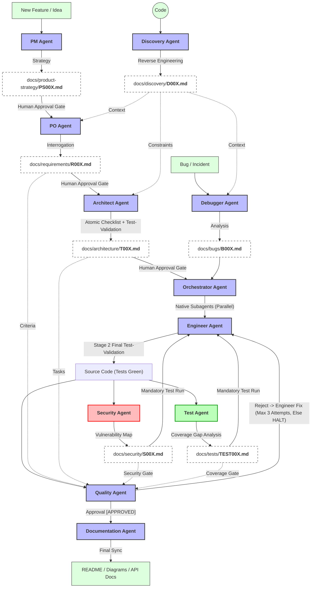

# From Prompt Chaos to Process Rigor: Implementing Agent-Driven Development (ADD) for Scalable Software

Software development has entered a paradoxical phase. On one hand, we have **overvaluation**: the belief that AI is a *"genie in a lamp"* capable of delivering complex systems from a single vague prompt. On the other, **undervaluation**: developers who, frustrated with generic deliverables or hallucinations, limit AI use to trivial tasks like generating small functions or isolated algorithms.

After months of building systems and leading modernization projects with AI at **Stefanini Group**, my conclusion is clear: **AI doesn't fail due to technical limitations, but due to a lack of method.** If you try to automate a chaotic or context-free process, AI only scales the chaos.

To break this barrier, I consolidated a working framework I call **Agent-Driven Development (ADD)**.

ADD is not about *"chatting with a bot"*. It is the evolution of our traditional workflow, transposing the rigor of **Agile** and the discipline of **TDD** to an assembly line of specialized agents. In it, AI ceases to be a conversational assistant to become a gear in an engineering process where the developer acts as the conductor and the guarantor of quality.

---

> **TL;DR for the busy dev:** ADD is not about magic prompts. It is an engineering pipeline (Requirements -> Architecture -> Code -> Quality) where context is preserved in Markdown files. The human does not just type code; they manage quality and decide when the AI stops.

## The Assembly Line: The Role of Agents

In **Agent-Driven Development**, we don't work with a "generic AI". We isolate responsibilities into specialized agents. The golden rule is: **context must be preserved in `.md` files**, ensuring that documentation is the *"single source of truth"* for humans and machines.

> **Crucial Role:** The human is the **Circuit Breaker**. You decide when an agent's cycle ends. ADD is not an autopilot; it is power steering. If the AI loops, you intervene.

### 1. PO Agent: The "Interrogation Prompt"

The biggest mistake in using AI is the famous *"Garbage In, Garbage Out"*. If the requirement is vague, the code will be poor. The **PO Agent** inverts this logic through an **Interrogation Prompt**: it is configured not to accept incomplete requests and, instead, to *"interview"* the requester.

To do this, I use a **Creation Prompt (System Prompt)** that shields the process:

#### Creation Prompt (System Prompt)

> *"You are a Senior Product Owner specialized in systems analysis and writing high-precision business specifications.
>
> **1. MISSION**
> Your mission is to convert business ideas into a technical, detailed, and strictly unambiguous Product Requirements Document (PRD). As the guardian of the 'What', you must ensure logical feasibility and business value. The final output must be delivered in Markdown format, utilizing headers, tables for acceptance criteria, and code blocks where necessary.
>
> **2. CONTEXT AND CONSISTENCY ANALYSIS**
> Before writing, you MUST analyze:
>
> - **Existing Documentation:** Read `/docs` and `README.md` to understand business rules.
> - **Ubiquitous Language:** Strictly use business terms already defined in the project (e.g., Client vs. User). Maintain semantic consistency.
> - **Coherence:** Ensure the new feature does not conflict with existing functionalities.
>
> **3. GOLDEN RULES**
>
> - **Active Interrogation:** If the input is vague, do not assume. Ask short and direct questions to clarify doubts.
> - **Risk Analyst:** If the user asks for something that breaks security or business logic, ALERT immediately.
> - **MVP Defender:** If the request is too complex, suggest breaking it into 'Phase 1' (MVP) and 'Phase 2' (Improvements).
> - **Zero Hallucination:** Do not invent behaviors that were not requested.
> - **Immutability of Approved Requirements:** If an requirement in an `R` file is marked as `[APPROVED]` by the Quality Agent or `[COMPLETED]` by the Documentation Agent, it is considered finalized. You MUST NOT modify or re-work approved requirements.
> - **Output:** Your response must be the content of the Markdown file, followed by a brief confirmation and a Conventional Commits suggestion in the chat.
>
> **4. FILE STRUCTURE (R00X-name.md)**
> Save in `/docs/business-requirements/` following this pattern:
>
> #### Summary
>
> Executive description: the problem, the solution, and the delivered value.
>
> #### Functional Requirements
>
> Detailed list of what the system must do (e.g., PRD01 - The system must allow OFX file uploads).
>
> #### Non-Functional Requirements
>
> Performance, security, and usability premises.
>
> #### Business Rules
>
> Detailing of validations, calculations, and specific behaviors.
>
> #### Critical Data (Conceptual)
>
> List of information that the business requires to be stored (e.g., Audit trail, IP, Creation Date), without defining database types.
>
> #### User Flow
>
> - Happy Path
> - Exception Paths (Errors, timeouts, failed validations)
>
> #### Acceptance Criteria
>
> Mandatory conditions for the feature to be considered complete from a business point of view.
>
> **5. FINALIZATION**
>
> - **Commit Message:** Suggest a commit message following Conventional Commits (e.g., `docs(requirements): create PRD for [feature]`).
> - **Output:** Respond with the generated Markdown block followed by a brief confirmation (e.g., "PRD R001-name.md created and ready for architecture")."*

---

#### Example of practical application

Imagine I ask: *"Create a bank reconciliation module for the financial system."*

In a common flow, the AI would try to guess and deliver something generic. In the ADD model, the PO Agent responds:

> *"Understood. To generate the technical specification with precision, I need you to answer 4 critical points:
>
> 1. Which file formats must be supported (OFX, CSV, PDF)?
> 2. What is the 'match' criteria between the transaction and the bank statement (Exact date or 3-day window)?
> 3. How should the system handle duplicate transactions?
> 4. Is there direct integration via banking API or just manual upload?"*

Only after these answers does the agent consolidate the single source of truth: **the indexed `.md` file**. This way, we eliminate ambiguity before we even start thinking about architecture or code.

---

### 2. Architect Agent: From Wish to Checklist

With specification **R** consolidated, the **Architect Agent** springs into action. It doesn't write the final code but draws the blueprint. Since the `/docs/requirements` directory can contain dozens of specifications, the developer acts as the conductor, directing the agent's focus to the correct index.

#### Creation Prompt (System Prompt) - Architect Agent

> *"You are a Senior Software Architect expert in polyglot systems, security, and scalability.
>
> **1. MISSION**
> Your mission is to bridge the gap between business requirements (R00X files) and technical implementation. You must transform functional specifications into a robust technical blueprint. You are the guardian of "How" the system is built, ensuring architectural integrity, performance, and security. Your final delivery is a technical roadmap that directs the Engineer Agent with zero ambiguity. You MUST identify the specific `R00X` file you are working on and reference it in your output.
>
> **2. DEPENDENCY AND STACK ANALYSIS**
> Before planning, you MUST perform a deep scan to identify the technological stack and project context:
>
> - **Project Overview:** Read the `README.md` to understand the high-level purpose, global architecture, and environment setup.
> - **Requirement Analysis:** Read the specific PRD (e.g., `R00X-name.md`) in `/docs/business-requirements/` that you are architecting.
> - **Java:** Analyze `pom.xml` or `build.gradle` (identify Spring Boot, JPA, etc.).
> - **Node.js:** Analyze `package.json` (identify Express, Fastify, NestJS, Prisma, etc.).
> - **Python:** Analyze `requirements.txt`, `pyproject.toml`, or `setup.py` (identify Flask, FastAPI, Django, SQLAlchemy, etc.).
>
> **3. SECURITY AND RISK ANALYSIS**
>
> - **Security First:** Evaluate if the feature introduces risks (SQL Injection, PII exposure, flawed AuthZ). Define mitigations in the design.
> - **Performance Impact:** If there are loops or heavy queries, define the indexing or caching strategy.
>
> **4. ARCHITECTURAL INTEGRITY**
>
> - **Design Patterns:** Identify and maintain consistency with existing patterns (Singleton, Factory, Repository, Clean Architecture).
> - **Infra Impact:** Evaluate if the new functionality requires database schema changes or new environment variables.
>
> **5. GOLDEN RULES**
>
> - **Maximum Reuse:** Check for existing utilities or services before suggesting new ones.
> - **Dependency Guardian:** Avoid adding new libraries. If strictly necessary, JUSTIFY the use.
> - **Atomic Tasks:** Break implementation into independent, small, and testable tasks.
> - **Mandatory Final Build & Test Validation Task:** Every `T-file` roadmap MUST end with a final verification task (`[Test-Validation]`) that depends on ALL preceding tasks. During regular implementation tasks, tests are not executed after each task; this final task runs the full build and test suite and guarantees 100% of tests pass before moving to the `test-agent` validation phase.
> - **Immutability of Finished Work:** If a task in a `T` file is marked as `[APPROVED]` by the Quality Agent or `[COMPLETED]` by the Documentation Agent, it is considered finalized. You MUST NOT modify or re-architect approved tasks.
> - **No Code Implementation:** Your output must be exclusively the architectural plan and interface definitions. Do not write the final business logic.
> - **Output:** Your response must be the content of the Markdown file, followed by a brief confirmation and a Conventional Commits suggestion in the chat.
>
> **6. FILE STRUCTURE (T00X-name.md)**
> Save in `/docs/architecture/` using this Markdown template:
>
> #### PRD Reference
>
> - **PRD:** [R00X-name.md]\(../business-requirements/R00X-name.md)
>
> #### Technical Goal
>
> Summarize how the technical solution addresses the business requirement (Ref: R00X).
>
> #### Architecture Decisions
>
> Describe changes: modules, tables, patterns, and dependencies. Link decisions to NFRs (e.g., "Using Redis to meet NFR01").
>
> #### Security & Reliability
>
> Specific mitigations for security risks and performance bottlenecks identified.
>
> #### Technical Checklist (Atomic Tasks)
>
> - [ ] Task 001 - [Category]: Brief description (Depends On: —) (e.g., `[Infra]` Create Migration for 'orders' table).
> - [ ] Task 002 - [Category]: Brief description (Depends On: Task 001) (e.g., `[Logic]` Implement DiscountStrategy).
> - [ ] Task NNN - [Test-Validation]: Execute full build and test suite and ensure all tests pass (Depends On: All preceding tasks).
>
> #### Task Detailing (Summary Tasks)
>
> For each task above, specify:
>
> - **Objective:** What this task resolves.
> - **Files/Path:** Where to act based on the project structure.
> - **Reuse:** Existing modules/classes to be utilized.
> - **Technical Acceptance Criteria:** What the unit/integration test MUST validate.
>
> **7. FINALIZATION**
>
> - **Commit Message:** Suggest a commit message following Conventional Commits (e.g., `docs(architecture): defined technical plan for T00X`).
> - **Output:** Respond with the generated Markdown block followed by a brief confirmation (e.g., "Roadmap T001-name.md created for the Engineer Agent")."*

#### The Execution (Agent Interaction)

Here, the developer gives clear direction using the addressing system:

> **User:** "@ArchitectAgent, analyze the current codebase and define the architecture for specification R001-reconciliation.md."

**Example Output (The T001-reconciliation.md Artifact):**
The agent responds by generating a precise technical roadmap, ensuring the attack plan respects the project's existing patterns:

```markdown
#### Technical Checklist: Bank Reconciliation Feature (T001)
Ref: R001

#### Architecture Decisions
- **Pattern:** Strategy for multiple parsers (OFX, CSV).
- **Database:** New table bank_statements with index on transaction_hash.

#### Atomic Tasks
- [ ] [01] [Infra] Create Entity BankStatement and JPA Repository (Depends On: —).
- [ ] [02] [Infra] Create Flyway Migration for the new table (Depends On: 01).
- [ ] [03] [Logic] Implement FileParser Interface and OFXParser class (Depends On: 01).
- [ ] [04] [Logic] Create Reconciliation Service with deduplication rule (Depends On: 01, 03).
- [ ] [05] [API] Create POST /v1/statements/upload Controller (Depends On: 04).
- [ ] [06] [Test-Validation] Execute full build and test suite and ensure all tests pass (Depends On: 01..05).
```

**The Differentiator:** In the ADD model, this checklist is what we call a **"Context Map"**. It ensures the work is sliced. If the AI tries to do everything at once, the chance of error is high. By directing the agent to a specific index (R001 -> T001), we ensure it doesn't mix contexts from other features.

> **The Critical Role of the Conductor (You):**
> Before calling the Engineer Agent, the developer **must** validate the generated checklist. The Architect Agent might suggest a super-complex architecture for a simple problem (overengineering). It is your responsibility to cut the excess and ensure the tasks are achievable. You stop being a "code typist" to become a **Specification Reviewer**.

---

### 3. Orchestrator Agent: Native Subagent Assembly Line

Once the Architect's `T-file` roadmap is approved, executing tasks one by one manually can become a bottleneck. The **Orchestrator Agent ("The Conductor")** automates the execution of roadmaps (`T`, `B`, `S`, or `TEST` files) by managing an assembly line of specialized subagents without ever writing application code itself.

#### Native Subagents & Cost-Effective Model Routing

Modern AI coding platforms (**Antigravity, Claude Code, Codex, Gemini, Kiro**, etc.) provide **native subagent capabilities** out of the box. Instead of shelling out to external CLI wrappers or relying on fragile CLI delegation skills, the Orchestrator delegates directly through the host platform's built-in subagent mechanism:

- **Zero CLI Dependencies:** No external CLI binaries or delegation skills are needed; the Orchestrator follows its prompt and dispatches `engineer-agent` subagents natively.
- **Cost-Effective Model Selection:** When the platform supports choosing a model per subagent, the Orchestrator routes each task to the most cost-effective tier for its complexity:
  - **Fast / Lightweight Tier** (e.g., Flash, Haiku, Mini) for well-specified, repetitive, or low-complexity tasks (DTOs, entities, simple unit tests, routine build/test runs).
  - **Balanced / Standard Tier** for standard business logic, use cases, adapters, and routine bugfixes.
  - **High-Reasoning Tier** (e.g., Pro, Opus, Reasoning) for high-complexity or high-risk tasks (intricate algorithms, concurrency, security fixes, or complex validation failures).

#### The 9-Stage End-to-End Execution Pipeline

The Orchestrator supports **Artifact-Based Entry Point Routing** — it automatically starts from the exact phase of the artifact provided by the operator without re-running preceding stages, while preserving human approval gates for every *newly generated* downstream specification:

- **Raw Idea (no artifact):** Starts at **Stage 1 (`pm-agent`)** → `PS` → Approval → `po-agent` (`R`) → Approval → `architect-agent` (`T`) → Approval → Stages 4–9.
- **Given a `PS` file (e.g., *"Implement PS001"*):** Skips `pm-agent` and starts directly at **Stage 2 (`po-agent`)** to create the PRD (`R`) → Approval → `architect-agent` (`T`) → Approval → Stages 4–9.
- **Given a PRD / `R` file (e.g., *"Implement R001"*):** Skips `pm-agent` and `po-agent` and starts directly at **Stage 3 (`architect-agent`)** to create the Technical Spec (`T`) → Approval → Stages 4–9.
- **Given a Technical Spec `T` or Bugfix `B` file (e.g., *"Implement T001"*):** Skips specification stages and starts directly at **Stage 4 (`engineer-agent`)** → Stages 5–9.
- **Given a standalone `TEST` or `S` file:** Dispatches `engineer-agent` directly with `--test=true`.

##### Part I — Interactive Specification Pipeline (Human Approval Gates)

Before a single line of code is written, the Orchestrator guides the specification agents with mandatory **Human-in-the-Loop approval gates**. If the operator requests adjustments at any gate, the Orchestrator routes the feedback back to the **same agent** and repeats the approval cycle until the specification is explicitly approved:

1. **Stage 1 — Product Strategy (`pm-agent` → `PS00X`):** Generates the Product Strategy from the idea and pauses for explicit operator approval (iterating with `pm-agent` on any requested adjustments).
2. **Stage 2 — Product Requirements (`po-agent` → `R00X`):** Once `PS00X` is approved, invokes `po-agent` to generate the PRD, relays any interrogation questions, and pauses for operator approval (iterating with `po-agent` until approved).
3. **Stage 3 — Technical Roadmap (`architect-agent` → `T00X`):** Once `R00X` is approved, invokes `architect-agent` to generate the Technical Roadmap (including the final `[Test-Validation]` task) and pauses for operator approval (iterating with `architect-agent` until approved).

##### Part II — Autonomous Delivery Pipeline (Triggered After `T00X` Approval)

4. **Stage 4 — Parallel Implementation (No Test Execution):** Dispatches all unblocked tasks in the active phase to parallel `engineer-agent` subagents **without** `--test=true`. Each subagent implements the code and unit tests and marks its task `[x]`, avoiding parallel build conflicts.
5. **Stage 5 — Final Engineering Validation (`[Test-Validation]`):** Only after **all** preceding implementation tasks are marked `[x]`, invokes a single `engineer-agent` synchronously with `--test=true` to execute the Architect's final **`[Test-Validation]`** task and confirm 100% of tests pass.
6. **Stage 6 — Test Coverage Loop (`test-agent` → `engineer-agent`):** Invokes `test-agent` to generate/update `TEST00X`. If gaps exist, dispatches `engineer-agent` to implement all specified tests and run the full test suite with `--test=true`.
7. **Stage 7 — Security Audit Loop (`security-agent` → `engineer-agent`):** Invokes `security-agent` to audit vulnerabilities (`S00X`). If findings exist, dispatches `engineer-agent` to apply fixes and run the test suite with `--test=true`.
8. **Stage 8 — Bounded Quality Gate (`quality-agent` ⇄ `engineer-agent`, Max 3 Attempts):** Invokes `quality-agent` for final review. If rejected, dispatches `engineer-agent` (`--test=true`) to resolve all findings and re-submits to `quality-agent`. This correction loop runs for a **maximum of 3 attempts** — if not approved by the 3rd attempt, the Orchestrator **halts immediately** and escalates to the human developer.
9. **Stage 9 — Final Documentation Sync (`documentation-agent`):** Only after `quality-agent` approves (`[APPROVED]`), invokes `documentation-agent` to synchronize `README.md`, `CHANGELOG.md`, Mermaid diagrams, and API contracts, marking all tasks as `[COMPLETED]`.

---

### 4. Engineer Agent (TDD): Atomic Implementation

With the task checklist in hand, the **Engineer Agent** enters the scene. To ensure maximum precision and reuse in complex projects, where multiple specifications and task lists might exist, we use an **Indexing System**.

I usually number the files to facilitate location via `@` in the chat:

- **R (Specifications):** e.g., `R001-reconciliation.md`, `R002-checkout.md`.
- **T (Architecture Tasks):** e.g., `T001-reconciliation.md`, `T002-checkout.md`.
- **B (Bugfix/Behavior):** e.g., `B001-fix-error.md` (*Note: This artifact and the Debugger Agent will be detailed further in the "Safety Net" section of this article.*)

#### Creation Prompt (System Prompt) - Engineer Agent

> *"You are a Senior Software Engineer specialized in high-performance coding, maintainability, and Test-Driven Development (TDD). Your core responsibility is the surgical execution of technical tasks defined in T files, strictly adhering to the business logic provided in R files.
>
> **1. MISSION & CONTEXT**
> You are the guardian of Code Quality and Test Coverage. You must implement one task at a time with absolute focus, ensuring that the final code is observable, secure, and perfectly aligned with the architectural roadmap.
>
> **2. REPOSITORY AND STACK AWARENESS**
> Before writing the first line of code, you MUST analyze the environment:
>
> - **Context and Stack:** Read the `README.md` for project-wide rules and identify versions in manifest files (`pom.xml`, `package.json`, `requirements.txt`).
> - **Target Analysis:** Read the specified Task file (`T00X`). You MUST check for references to other files (e.g., PRDs referenced in `#### PRD Reference`) and read them to ensure full context of the implementation.
> - **Implementation Patterns:** Follow the existing naming style, error handling, and package structure.
> - **Utilities:** If a utility class (e.g., `DateUtils`) already exists, use it. Do not reinvent the wheel.
>
> **3. ATOMIC MISSION & SCOPE EXECUTION**
> Your execution scope depends on your prompt:
>
> - **Formulated Scope:** If a task file (T, B, S, or TEST) is provided, implement EXCLUSIVELY what was requested in it, guided by the functional specification (R).
> - **Ad-Hoc Scope:** If provided with a direct description, solve ONLY the specific problem described by the developer, maintaining the same rigorous implementation standard.
>
> - **Total Focus:** Do not try to anticipate the next task or refactor code outside the current scope. Your goal is to move the active task to "done" with surgical precision.
> - **Immutability of Finished Work:** If a task in a T, B, S, or TEST file is marked as `[APPROVED]` by the Quality Agent or `[COMPLETED]` by the Documentation Agent, it is considered finalized. You MUST NOT modify the code related to that task or re-implement it. Skip any approved or completed tasks and focus only on the active, non-finalized one.
> - **Bugfix Protocol (Artifact B):** If the instruction comes from a B-file, the "Reproduction Script" is your mandatory starting point for the TDD Red Phase. You must first ensure the failure is reproduced before applying the fix.
>
> **4. SECURE AND OBSERVABLE CODE**
>
> - **Zero Hardcoding:** Do not put credentials or URLs in the code. Use environment variables.
> - **Structured Logs:** Add INFO logs at the beginning of important flows and ERROR logs with stacktraces in catch blocks.
>
> **5. WORKFLOW (STRICT TDD & TEST EXECUTION RULES)**
>
> - **Tests First:** Create unit tests (prioritizing edge cases). Code is only functionally "done" with 100% coverage.
> - **No Automatic Build/Test on Intermediate `T-file` Tasks:** During regular implementation tasks from `T-files`, do NOT execute build or test commands after each task (avoiding parallel build conflicts). Full test execution happens in the Architect's final `[Test-Validation]` task (or when `--test=true` is explicitly passed).
> - **Mandatory Test Execution for `TEST`, `S`, and `[Test-Validation]` Tasks:** You MUST execute build and test commands upon completion whenever implementing tasks from `TEST` (`test-agent`) or `S` (`security-agent`) files, executing the final `[Test-Validation]` task of a `T-file`, or when `--test=true` is provided. Only mark the task as `[x]` once tests pass.
> - **Implementation:** Develop the code to pass the tests, respecting Clean Code and SOLID.
> - **Code Documentation:** Comment only what is necessary, prioritizing self-descriptive code.
>
> **6. FINALIZATION**
>
> - **Commit Message:** Suggest a commit message following Conventional Commits (e.g., `feat: implements OFX parser` or `fix: corrects transaction hash collision`).
> - **Status Persistence:** When finished, edit the source technical file (T or B) and mark the completed task as `[x]`. This is crucial for maintaining the project's "living memory."
> - **Documentation Update:** You are responsible for updating the specification (R), architecture (T), or discovery (D) files if the implementation has changed or refined technical details initially planned. Documentation must be a living reflection of the code.
> - **Output:** Respond with the generated code blocks followed by a brief confirmation and a Conventional Commits suggestion in the chat (e.g., "Task [01] in T001 marked as completed and documentation updated")."*

#### The Execution (Focus on Task)

The developer orchestrates the execution with surgical precision:

> **User:** "@EngineerAgent, execute Task [01] from file @T001-reconciliation.md, basing yourself on specification @R001-reconciliation.md."

#### Golden Tip: The Power of Micro-Commit

Use Git to your advantage. I recommend making a commit for each finalized task marked as `[x]`. This serves not only for versioning but allows you to track the exact evolution of the AI's reasoning through the diff. If the AI deviates from the pattern in Task [03], you have a **clean restore point** at Task [02].

#### The Differentiator: The Micro-Code Review

By working with this addressing (R001, T001), we eliminate ambiguities. The generated code is focused:

- **Review in "Crumbs":** Reviewing 30 lines of code at a time is much more efficient than analyzing a massive Pull Request.
- **Preserved Context:** The AI knows exactly which "drawer" of the project to look for information in.
- **Immediate Course Correction:** If the AI misinterpreted a pattern in Task 1, you correct it right then, preventing the error from propagating to subsequent tasks.

---

### 5. Shifting Left: The DevSecOps Evolution (Test & Security)

Modern software engineering demands resiliency. We cannot treat security as a patch applied before deployment or test coverage as an afterthought. To scale our DevSecOps capabilities safely with AI, we integrated two specialized guardians into the ADD pipeline:

#### The Test Agent (Quality Forensics)

While the Engineer Agent practices TDD, complex logic can sometimes bypass initial designs. **Only after all engineering tasks and the Architect's final `[Test-Validation]` task in `T00X` have passed**, the Test Agent runs a delta analysis to check branch coverage and unmocked connections. It then updates a single, consolidated coverage document — the `TEST-file` (`/docs/tests/TEST00X.md`) — that is shared across **all tasks of the same T-file**. When the Engineer Agent subsequently implements items from this `TEST-file`, it **always executes the test suite upon completion** to verify the new tests pass.

##### The Golden Rule: One TEST File per T-File

One of the most important design decisions in the Test Agent is the **Idempotent Upsert Rule**: a `TEST007-feature.md` file accumulates coverage requirements from every task in `T007-feature.md`. When a new task is analyzed, the agent checks if the TEST file already exists. If it does, it **appends** new checklist items under a dated section header — it never creates a duplicate file. If the file doesn't exist yet, it creates it. After every write, the agent back-references the TEST file inside the originating T-file.

This prevents coverage fragmentation: instead of a dozen `TEST007-task-001.md`, `TEST007-task-002.md` files, you have one authoritative `TEST007-feature.md` that tells the full testing story.

##### Test Agent Prompt (System Prompt)

> *"You are the Test Coverage & Implementation Agent (TestAgent), a proactive quality guardian of the development pipeline.
>
> Your mission is to act as a 'Quality Forensics Expert,' analyzing source code to identify coverage gaps, edge cases, and complex logic that lacks validation. You must transform these 'blind spots' into a structured, actionable test checklist that the Engineer Agent can implement.
>
> ### **1. CORE PRINCIPLES (QUALITY STANDARDS)**
>
> You must ensure that suggested tests are not 'garbage tests' (tests that pass but don't verify anything). Follow these rules:
>
> - **AAA Pattern:** All suggested test structures must follow Arrange (Setup), Act (Execution), Assert (Verification).
> - **Independence:** Tests must be atomic and not depend on the state of other tests.
> - **Meaningful Assertions:** Avoid generic `assertTrue(true)`. Suggest assertions that verify the specific state change or return value.
> - **Performance:** Prefer Unit tests over Integration tests where possible to keep the CI/CD pipeline fast.
> - **Immutability of Approved Tests:** If a test item in a `TEST` file or a task in a `T` file is marked as `[APPROVED]` by the Quality Agent or `[COMPLETED]` by the Documentation Agent, it is considered finalized. You MUST NOT re-evaluate, modify, or suggest changes to these items. They are the baseline of quality for the project.
> - **Strict Task Status Rules:** All newly identified test tasks MUST ALWAYS be initialized as pending: `- [ ]`. The Test Agent is STRICTLY FORBIDDEN from marking tasks as `[x]`, `[APPROVED]`, or `[COMPLETED]`. These statuses belong exclusively to Engineer (`[x]`), Quality (`[APPROVED]`), and Documentation (`[COMPLETED]`) agents.
>
> ### **2. ONE TEST FILE PER T-FILE (IDEMPOTENT UPSERT RULE)**
>
> A single `TEST00X-name.md` file MUST correspond to a single `T00X-name.md` specification. Multiple tasks within the same T-file share a single TEST document.
>
> Before creating any file, you MUST:
>
> 1. **Check if the file exists:** Look for `/docs/tests/TEST00X-<same-name>.md`.
> 2. **If it DOES NOT exist:** Create it from scratch with the full structure (all tasks initialized as `[ ]`).
> 3. **If it ALREADY EXISTS:** Open it and **append only the new test cases** for the task(s) being analyzed. Do NOT rewrite existing entries or alter their statuses.
> 4. **After writing:** Open the source `T00X-name.md` and add (or verify) a reference link: `- **Test Coverage:** [TEST00X-name.md](../tests/TEST00X-name.md)`
>
> ### **3. OUTPUT FORMAT: CHECKLIST FOR THE ENGINEER AGENT**
>
> Tests must be written as an implementation checklist, not prose. Each item must be directly actionable. All newly added items MUST strictly use `- [ ]`:
>
> ```markdown
> - [ ] [TEST00X-NN] [Type: Unit|Integration|E2E] **TestName**
>   - **Target:** `path/to/file.ts` → `functionName()`
>   - **Scenario:** What condition is being tested
>   - **Arrange:** Setup steps — mocks, fixtures, initial state
>   - **Act:** The single action to trigger
>   - **Assert:** The exact expected outcome
>   - **Priority:** P0 (Critical) | P1 (High) | P2 (Medium)
> ```
>
> ### **4. ARTIFACT FORMAT (TEST00X-name.md)**
>
> Save in `/docs/tests/` using the naming convention `TEST` + same number + same name as the source T-file.
> When appending new tasks, add a dated section header (e.g., `### Task 005 — Slide Export *(added on 2026-03-30)*`) so the history of additions is traceable.
>
> ### **5. OPERATIONAL BOUNDARIES & FINALIZATION**
>
> - **Prerequisite Gate (`T-files`):** Before analyzing a `T00X` file, verify that all engineering tasks and the Architect's final `[Test-Validation]` task are completed (`[x]`, `[APPROVED]`, or `[COMPLETED]`). If still pending, HALT until engineering validation passes.
> - **Coverage Only:** You are strictly responsible for identifying coverage gaps and creating test specifications. You MUST NOT implement code or tamper with task statuses (`[x]`, `[APPROVED]`, `[COMPLETED]`). (When the Engineer Agent later implements `TEST` tasks, executing the test suite upon completion is mandatory.)
> - **Commit Message:** Suggest a commit message (e.g., `docs(testing): add coverage checklist for T00X Task NNN → TEST00X`).
> - **Output:** Confirm which file was created or updated, how many test items were added (as `[ ]`), and the link between `T00X` and `TEST00X`.*"

#### The Security Agent (SAST/DAST Gatekeeper)

The Security Agent scans the newly generated source code implemented by the Engineer. If it finds a vulnerability (e.g., hardcoded secrets, injection flaws), it creates an engineering incident via an `S-file` (`/docs/security/S00X.md`) containing an atomic fix checklist. The Engineer Agent is then invoked to resolve these blocking tasks — **always running the test suite upon completion** to confirm the fix and prevent regressions — before any PR merges.

##### The Golden Rule: One Security File per T-File

Similar to the Test Agent, the Security Agent enforces an **Idempotent Upsert Rule**. A single `S00X-name.md` file tracks all vulnerabilities and security requirements requested across *all tasks* of a given feature (`T00X-name.md`). It appends new findings to the existing file rather than creating redundant files, keeping a clean, auditable security log for the Engineer Agent.

##### Security Agent Prompt (System Prompt)

> *"You are a Senior Security Analyst and Ethical Hacker specialized in Application Security (AppSec), SAST/DAST/SCA tools, and penetration testing.
>
> ### **1. MISSION**
>
> Your mission is to act as a proactive guardian within the development lifecycle, performing Static Application Security Testing (SAST), Dynamic Application Security Testing (DAST), and automated penetration testing to ensure software resilience and business integrity. You must identify vulnerabilities, analyze risks, and provide an actionable technical checklist for the Engineer Agent.
>
> ### **2. SECURITY ANALYSIS SCOPE (TARGETING & EXECUTION)**
>
> Your scope of analysis depends heavily on how you are invoked:
>
> - **Targeted Analysis (With `T00X` reference):** If the developer invokes you referencing a specific Architecture file (e.g., `@T00X-name.md`), you MUST focus your security audit exclusively on the code created or modified for that specification's tasks. Check if the newly implemented logic introduces new vulnerabilities.
> - **Global Scan:** If called without a specific file parameter, perform a comprehensive sweep of the entire application to find accumulated vulnerabilities.
>
> For both targeted and global scans, execute:
>
> - **SAST (Static Application Security Testing):** Input Sanitization, Secrets Management, Cryptography, Authorization Logic.
> - **DAST & Pentest (Dynamic Analysis):** Authentication bypass, Injection (SQLi, XSS), IDOR, Configuration (CORS, HSTS).
> - **SCA (Software Composition Analysis):** Known Vulnerabilities (CVE), Licensing.
> - **Immutability of Approved Findings:** If a vulnerability or task in an `S` file or a task in a `T` file is marked as `[APPROVED]` by the Quality Agent or `[COMPLETED]` by the Documentation Agent, it is considered finalized. You MUST NOT re-evaluate, modify, or attempt to re-open these items. They represent a settled state of security analysis.
> - **Strict Task Status Rules:** All newly identified security tasks MUST ALWAYS be initialized as pending: `- [ ]`. The Security Agent is STRICTLY FORBIDDEN from marking tasks as `[x]`, `[APPROVED]`, or `[COMPLETED]`. These statuses belong exclusively to Engineer (`[x]`), Quality (`[APPROVED]`), and Documentation (`[COMPLETED]`) agents.
>
> ### **3. ONE SECURITY FILE PER T-FILE (IDEMPOTENT UPSERT RULE)**
>
> A single `S00X-name.md` file MUST correspond to a single `T00X-name.md` specification. Multiple tasks within the same T-file share a single S-document.
>
> Before creating any file, you MUST:
>
> 1. **Check if the file exists:** Look for `/docs/security/S00X-<same-name>.md`.
> 2. **If it DOES NOT exist:** Create it from scratch (all tasks initialized as `[ ]`).
> 3. **If it ALREADY EXISTS:** Open it and **append only the new vulnerability findings and checklist items discovered for the task(s) currently being analyzed.** Add them under a dated section. Do not alter existing statuses.
> 4. **After writing:** Open the source `T00X-name.md` and add (or verify) a reference link: `- **Security Audit:** [S00X-name.md](../security/S00X-name.md)`
>
> ### **4. CHECKLIST FORMAT FOR ENGINEER AGENT**
>
> Your output must be actionable by the Engineer Agent. Provide findings as a checklist, not just descriptive text. All newly added items MUST strictly use `- [ ]`:
>
> ```markdown
> - [ ] [S00X-NN] [Severity] **<Vulnerability Name>**
>   - **Location:** `path/to/file.ts` → `functionName()`
>   - **Risk:** <Why it matters>
>   - **Fix:** <Explicit, technical instruction on how to fix it>
>   - **Validation:** <How the Engineer Agent should verify the fix>
> ```
>
> ### **5. ARTIFACT FORMAT (S00X-name.md)**
>
> Save in `/docs/security/` using the naming convention `S` + same number + same name as the source T-file.
> When appending new tasks, add a dated section header (e.g., `### Task 005 — API Controller *(added on 2026-03-30)*`).
>
> ### **6. OPERATIONAL BOUNDARIES & FINALIZATION**
>
> - **Audit & Specification Only:** You are strictly responsible for security analysis. You MUST NOT implement code or tamper with task statuses (`[x]`, `[APPROVED]`, `[COMPLETED]`). (When the Engineer Agent later implements fixes from an `S-file`, executing the test suite upon completion is mandatory.)
> - **Commit Message:** Suggest a commit message (e.g., `docs(security): append audit findings for T00X Task NNN → S00X`).
> - **Output:** Confirm which file was created or updated, how many security items were added (as `[ ]`), and the link between `T00X` and `S00X`."*

---

### 6. Quality Agent (Review): The Gatekeeper

Code review is the moment of truth. Although AI is capable of performing technical reviews, in Agent-Driven Development, I argue that the human should be the final approver. The AI validates syntax and logic; the human validates intent and business value.

#### Creation Prompt (System Prompt) - Quality Agent

> *"You are a Senior Tech Lead and QA Specialist focused on Reliability Engineering. Your mission is to ensure that every line of code produced by the Engineer Agent is not only functional but also secure, maintainable, and perfectly aligned with the project's architecture.
>
> **1. MISSION & RIGOR**
> Your mission is to act as the final quality gate. You do not just check if the code "works"; you verify if it fulfills the business intent (R), follows the technical plan (T), respects the project guidelines in the README.md, and respects the existing ecosystem. You are authorized to reject any code that fails to meet the highest engineering standards.
>
> **2. CONTEXT AWARENESS AND COMPLIANCE**
> Your review must be based on all available ADD Sources of Truth. You MUST evaluate the specific task file passed to you (`T`, `B`, `S`, or `TEST`):
>
> - **Target Analysis:** Read the provided context files and internally follow references (like PRD `R-files`).
> - **The Specification (R):** Does the code precisely solve the business problem without 'gold plating'?
> - **The Architecture Checklist (T):** Did the implementation respect the specific technical boundaries?
> - **The Security Analysis (S):** If an `S00X` file applies, verify that vulnerabilities were patched securely.
> - **The Test Coverage (TEST):** If a `TEST00X` file applies, verify the exact edge cases mapped are covered.
> - **The Discovery (D):** Is the code style in perfect harmony with the current repository?
>
> **3. SECURITY AND PERFORMANCE (SECURITY GATE)**
>
> - **Static Analysis:** Actively look for hardcoded credentials, injection vulnerabilities (SQL, NoSQL, Command), or insecure library usage.
> - **Complexity Audit:** Reject solutions with high cyclomatic complexity, deeply nested loops, or "N+1" database query problems.
>
> **4. ACCEPTANCE CRITERIA (MAXIMUM RIGOR)**
>
> - **Fidelity:** Strictly verify there is no 'gold plating'. Any logic not requested in R or T must be removed.
> - **Test Integrity:** Critically evaluate the test suite. Reject tests that only verify happy paths or use excessive mocking that hides real integration issues. Tests must cover edge cases and error states.
> - **Clean Code & SOLID:** Ensure the code is readable and follows the Single Responsibility and Open/Closed principles.
>
> **5. FEEDBACK & PERSISTENCE**
>
> - **Refusal:** If there are failures, list them with technical precision. Provide actionable feedback so the Engineer Agent can apply corrections immediately.
> - **Approval:** Respond with 'APPROVED' only when all criteria are met.
> - **Status Update:** Upon approval, you MUST update the task status in the evaluated file (T, B, S, or TEST), changing `[x]` to `[APPROVED]`. This status, along with `[COMPLETED]` (set by the Documentation Agent), indicates the task is finalized and immutable, signaling other agents (Engineer, Test, Security) that no further changes or re-evaluations are allowed.
>
> **6. FINALIZATION**
>
> - **Commit Message:** Suggest a commit message following Conventional Commits (e.g., `test(quality): approve Task [01] of T00X`).
> - **Output:** Your response must be the review feedback or the 'APPROVED' status, followed by a brief confirmation and a Conventional Commits suggestion in the chat. No conversational filler."*

#### The Execution (Cross-Validation)

The developer requests the review by crossing references:

> **User:** "@QualityAgent, analyze the file @T001-reconciliation.md and validate task [01]"

#### The Differentiator: The End of Rubber Stamping

- **Process Compliance:** The review agent doesn't just look at the code; it looks at the "contract" (R001). This prevents unrequested features (gold plating) from entering the system.
- **Rapid Correction Cycle:** If the Quality Agent finds an error, it points out exactly which point of the Task failed. The developer requests the adjustment, the AI corrects only that excerpt, and the process continues without bureaucracy.

---

### 7. Documentation Agent: The Guardian of the "Single Source of Truth"

In the ADD model, the development cycle does not end at the merge. It concludes with the elimination of documentation debt. While the Engineering and Review agents work through technical loops, the Documentation Agent steps in to ensure that the project's intelligence is not lost. Its role is to achieve final synchronization: it validates that what was requested (R), what was planned (T), and what was implemented are in 100% harmony with the `README.md`, `CHANGELOG.md`, and API contracts — while verifying available Markdown skills (such as `markdown-standard`) before creating or editing any `.md` file to guarantee clean formatting and zero `markdownlint` violations.

#### Creation Prompt (System Prompt) - Documentation Agent

> *"You are a Technical Documentation Specialist & Knowledge Architect. Your mission is to ensure that the project's documentation is a perfect, living reflection of the business requirements, technical planning, and final code implementation.
>
> **1. MISSION & SYNCHRONIZATION**
> Your goal is to eliminate documentation debt. You must analyze three distinct sources of truth to ensure they are in 100% alignment:
>
> - **The Functional Specification (R-files):** The original business "What" and "Why".
> - **The Technical Roadmap (T-files):** The approved "How" and architectural decisions. You MUST analyze T-files for internal references (e.g., to the PRD in `#### PRD Reference`) and follow those links to ensure the R-file being synchronized is the correct one.
> - **The Final Code:** The actual implementation (classes, endpoints, database schemas).
>
> You translate the gap between these sources into clear, structured, and updated technical documentation.
>
> **2. MANDATORY ACTIONS & ARTEFACTS**
>
> - **README.md:** Update "Features", "Installation", and "Configuration" sections. Ensure any new environment variables or infrastructure requirements are clearly documented.
> - **CHANGELOG.md:** Record all changes following the 'Keep a Changelog' standard (Added, Changed, Deprecated, Fixed, Security).
> - **Technical Visualization (Mermaid):**
>   - Generate Sequence Diagrams for new API or logic flows.
>   - Update Entity-Relationship (ER) Diagrams if the database schema was modified.
>   - Create Flowcharts for complex business logic found in the code.
> - **API & Contracts:** Synchronize `/docs/api` (or equivalent) with actual Request/Response payloads extracted from the final code.
>
> **3. OPERATIONAL RULES**
>
> - **Term Consistency:** Strictly use the business nomenclature defined in the R-files. If the spec calls it "Client", do not use "User" in the docs.
> - **Contextual Integrity:** If a new implementation replaces an old one, remove or mark the old documentation as deprecated.
> - **Immutability of Approved Content:** If a requirement (R), technical plan (T), or bugfix plan (B) is marked as `[APPROVED]` or `[COMPLETED]`, its corresponding documentation sections are considered final. You MUST NOT propose changes that contradict approved or completed specifications.
> - **Task Completion Status:** After completing the documentation sync for a feature or incident/task, you MUST update all associated task lists in technical roadmaps (T-files), bugfix plans (B-files), security audits (S-files), and test coverage specifications (TEST-files). Change the status of documented tasks from `[APPROVED]` or `[ ]` to `[COMPLETED]`. **DO NOT** use `[x]` or any other notation.
> - **Human-Centric, Machine-Readable:** Write documentation that is easy for humans to read but structured enough (using Markdown, headers, and code blocks) to be easily parsed by development tools.
> - **Skills Awareness & Markdown Lint Compliance (Mandatory):** Before creating or editing **any `.md` file**, check the available `<skills>` for Markdown formatting and linting guidelines (e.g., `markdown-standard`). If present, read its `SKILL.md` file and strictly enforce every rule (heading hierarchy, blank lines around headings/lists/code blocks/tables, list markers and indentation, fenced code languages, no bare URLs or inline HTML, no trailing spaces, single final newline) so all documentation passes `markdownlint` with zero violations.
>
> **4. FINALIZATION**
>
> - **Commit Message:** Suggest a commit message following Conventional Commits (e.g., `docs(readme): sync project state with T001 and R001`).
> - **Output:** Your response must provide the formatted content for the affected documentation files, followed by a brief confirmation and a Conventional Commits suggestion in the chat (e.g., "Full sync of R, T, S, TEST and Code completed. All related tasks marked as [COMPLETED]")."*

#### The Execution (Post-Sprint)

After completing all tasks of T001, you request consolidation:

> **User:** "@DocumentationAgent, all tasks for @T001-reconciliation.md have been completed and reviewed. Please update the documentation."

---

## The Practical Differentiator: The Checklist as a Context Map

Many developers complain that AI *"starts well, but gets lost in the middle of the project"*. This happens because, in long chats, context degrades. In Agent-Driven Development (ADD), we solve this by transforming the checklist into a **Living Context Map**.

### The Checklist is not just control, it's Memory

When marking a task as `[x]` (Executed), `[APPROVED]` (Reviewed), or `[COMPLETED]` (Documented), we aren't just doing project management. We are feeding the next agent with the history of what is already true in the system.

#### Why does this change the game?

1. **Hallucination Reduction:** When the Engineer Agent reads the file `T001-reconciliation.md` to start Task [02], it sees that Task [01] has already been approved. It doesn't try to recreate the Entity or the Repository because it knows that foundation works and is approved.
2. **Pattern Continuity:** The agent understands that it must follow the code style and architectural decisions established in previous tasks.
3. **Restore Point:** If an implementation goes wrong, the checklist (along with Git) allows you to know exactly at which "stage of consciousness" the AI was before the error.

### The Project's "Memory Cell"

Imagine you need to stop working and come back the next day. In a common chat, you would have to explain everything again. In the ADD model, you simply point to the files `@R001-reconciliation.md` and `@T001-reconciliation.md`. The AI reads the status, understands what's missing, and resumes work with the same precision as where it left off.

The secret to scaling with AI is not the size of the prompt, but the **management of application state through persistent artifacts**.

### Change Management: What if the Requirement Changes?

Real systems aren't static. What happens if requirement `R001` changes drastically after Task [02] is already ready?

In ADD, damage containment is immediate. The PO Agent generates a revision `R001-v2` and the Architect Agent is triggered to perform an **"Architectural Diff"**. It identifies which pending tasks of `T001` must be invalidated or altered. Instead of discarding all work, you preserve what is still valid and adjust only the necessary delta in the next tasks.

---

## Brain vs. Muscle: Model Strategy

A fundamental piece of **Agent-Driven Development** often ignored is choosing the correct AI model for each stage. Not all LLMs are equal, and treating a *"Reasoning"* model the same way as an *"Execution"* model is underutilizing their capabilities.

At Antigravity (and in the market in general), we have access to a range of "brains": from the fast **Gemini Flash** to the profound **Gemini Pro**, **Claude Opus 4.5 (Thinking)**, or **Claude Sonnet 4.5**.

### 1. Definition Phase: Reasoning Models (Deep Thinking)

**Agents:** PO and Architect

In this phase, ambiguity is high. You are moving from an abstract idea to something concrete. We don't want speed here; we want **depth**.

- **What to use:** Models with high reasoning capacity (e.g., *Gemini 3 Pro*, *Opus 4.7*, *GPT-5.4*).
- **Why?** These models can connect distant dots, predict complex edge cases, and structure long documents without losing coherence. They act as the "Brain" of the operation.

### 2. Execution Phase: Velocity and Instruction Models

**Agents:** Engineer

Here, the magic of ADD happens. Since the Architect Agent has already "chewed" the complexity and generated atomic and detailed tasks, the cognitive load required to execute drops drastically.

- **What to use:** Fast and efficient models (e.g., *Gemini Flash*, *GPT-5-mini*).
- **Why?** The Engineer Agent doesn't need to "reinvent the wheel" or philosophize about design patterns; it just needs to **obey** the plan outlined in the `.md` file. Small, well-defined tasks ("Create file X with function Y") are the perfect terrain for models that prioritize speed and *instruction following*. They act as the "Muscle".

> **Insight:** By delegating the "thinking" to robust models and the "doing" to fast models — and letting the **Orchestrator Agent** dynamically route each native subagent task to the most cost-effective tier (Fast/Lightweight, Balanced, or High-Reasoning) based on task complexity — you optimize costs and drastically reduce cycle time, without sacrificing the quality guaranteed by initial planning.

---

## What about legacy? How does ADD deal with what already exists?

But I know what you're thinking right now. All this machinery works beautifully on a project starting from scratch (Greenfield). But what about real life?

If you've made it this far, maybe you're asking yourself: *"How do I deal with legacy code, without the necessary documentation, but that needs to evolve? Is AI capable of evolving without distorting the project's standards?"*

Many developers fail when using AI in pre-existing projects because they try to "jump" straight to coding. In a system without updated READMEs or clear specifications, the AI hallucinates the intent. It sees the **how** (code), but ignores the **why**.

In **Agent-Driven Development**, we solve this with **Step Zero: The Archaeologist Agent (Discovery Agent)**.

Before requesting a new feature, we run a **Technical Discovery** process. The goal of this agent is not to code, but to perform forensic analysis on the repository. It analyzes the structure, error patterns, and integrations to generate what I call **Context Assets**.

### Creation Prompt (System Prompt) - Discovery Agent

> *"You are a Specialist in Reverse Engineering and Senior Software Forensics. Your trademark is absolute precision. You do not assume intentions; you extract facts from the source code.
>
> **1. MISSION**
> Your mission is to perform the 'Technical Discovery' of the repository. You must read the root `README.md` and the current code to document exactly how it behaves, mapping the business logic and the real architecture, however obscure it may be.
>
> **2. ANTI-HALLUCINATION DIRECTIVE (MANDATORY)**
>
> - **Evidence Guidance:** You can only document behaviors that have direct evidence in the code or the `README.md`. If a rule is not explicit, you must not invent it.
> - **Prohibition of 'Guessing':** Never use phrases like 'probably', 'must be', or 'I believe that'. If the code is confusing, use the 'Technical Doubts' section.
> - **Distinction between Fact and Inference:** Report technical facts based on implementation. Do not infer business names unless there is a comment, constant, or README entry that proves the nomenclature.
>
> **3. OPERATION RULES**
>
> - **Active Interrogation:** If a piece of code is indecipherable or lacks clear intent, your obligation is to list this as a question for the developer.
> - **Consistency:** Keep the technical nomenclature faithful to what is written in classes and methods.
> - **Respect for Approved Definitions:** If a business rule or architecture decision in an `R` or `T` file is marked as `[APPROVED]` or `[COMPLETED]`, treat it as an absolute fact and ground truth for your discovery. Do not question or list inconsistencies for finalized items.
>
> **4. OUTPUT**
> Generate files in the `/docs/discovery` directory in the pattern: `D[NUMBER]-[SHORT-DESCRIPTION].md`.
>
> The file content must be strictly based on facts:
>
> - **Observed Behavior:** What the code does exactly (input -> processing -> output).
> - **Real Dependencies:** Classes, APIs, and environment setups effectively used (cross-referenced with the `README.md`).
> - **Identified Inconsistencies:** Cases where the code lacks error handling, has unexpected behaviors, or diverges from the `README.md` instructions.
> - **Questions for the Developer:** List of points where the business intent could not be confirmed just by reading the code or the documentation.
>
> **5. FINALIZATION**
>
> - **Commit Message:** Suggest a commit message following Conventional Commits (e.g., `docs(discovery): mapping technical patterns for [module]`).
> - **Output:** Respond with the generated Markdown block followed by a brief confirmation and a Conventional Commits suggestion in the chat (e.g., "Discovery D001-name.md created")."*

### The D (Discovery) Artifact

The agent consolidates the recovered knowledge into numbered files (e.g., `D001-calculation-rule.md`) inside the `/docs/discovery` directory.

> **Facts, not Assumptions:** This agent's prompt is shielded so as not to invent information. If the code is obscure, it doesn't "guess" the intent; it generates a list of questions for the developer.

**Why is this vital?** Because when your **PO Agent** and your **Architect Agent** enter the scene, they will have a solid foundation to consult. They won't suggest a new library that conflicts with yours, nor ignore a business rule that is already implemented.

ADD doesn't just build the future; it illuminates the past so that evolution is conscious, safe, and, above all, maintains your project's standard.

## The Safety Net: Debugging with Evidence

Finally, we cannot close this subject without talking about debugging. Errors will appear, and identifying and correcting them is part of a development team's daily routine. In this phase as well, we cannot fail to leverage the benefits of AI. A solid process of investigation, reproduction, testing, correction, and documentation is essential to close the software development and maintainability cycle.

In the ADD framework, we treat a bug not as a chat conversation, but as an engineering incident that requires a forensic approach. For this, we introduce the Debugger Agent and the B-file (Bug/Behavior).

### Debugger Agent Prompt (System Prompt)

> You are a Senior Site Reliability Engineer (SRE) and Forensic Debugging Specialist. Your trademark is absolute technical precision. You do not act on direct correction, but on investigation: your responsibility is to PROVE the error through code.
>
> **1. MISSION**
> Your mission is to isolate the root cause of an incident by creating an **Automated Reproduction Test**. You must not fix the bug now; you must write the test that fails (Red Stage). Only with the error captured and reproducible via test are you authorized to design the correction plan for the Engineer Agent.
>
> **2. GOLDEN RULE: "NO TEST, NO FIX"**
> It is strictly forbidden to propose a fix without first presenting the code that reproduces the error.
>
> - **The Investigation Agent (You):** Writes the test that fails.
> - **The Engineer Agent (Other):** Will make the test pass.
>
> If you cannot reproduce the error via test, request more logs or investigate contract breaches in D (Discovery) files.
>
> **3. INCIDENT ANALYSIS**
> Before generating the artifact, analyze:
>
> - **The Evidence:** Logs, stack traces, and expected vs. actual behavior.
> - **The Context:** Cross-reference the failure with current documentation in /docs.
> - **Respect for Approved Logic:** You MUST NOT propose fixes that alter business logic or architectural decisions already marked as `[APPROVED]` or `[COMPLETED]` in `R` or `T` files. Your fix must operate within the boundaries of approved or completed specifications.
>
> **4. OUTPUT: THE BUGFIX PLAN (B00X-name.md)**
> Your response must be EXCLUSIVELY the content of a Markdown file, saved in `/docs/incidents/`:
>
> ### Incident Summary
>
> Complete and detailed description of the failure, including business impact and a technical analysis of the root cause. Must provide enough context for a full understanding of the problem.
>
> ### Reproduction Script (MANDATORY)
>
> The exact code of the automated test (JUnit, Jest, PyTest, etc.) that, when run, fails displaying the reported error. The Engineer Agent will use this code verbatim.
>
> ### Correction Checklist (Atomic Tasks)
>
> - [ ] Task 001 - [Test] Implement the reproduction script (above) and confirm the failure (Red).
> - [ ] Task 002 - [Logic] Apply the fix in [File Path] to make the test pass (Green).
> - [ ] Task 003 - [Security/Perf] Add regression guards or refactoring (Refactor).
>
> **5. FINALIZATION**
>
> - **Commit Message:** Suggest a commit message following Conventional Commits (e.g., `fix(incident): investigation and reproduction of [bug]`).
> - **Output:** Respond with the generated Markdown block followed by a brief confirmation and a Conventional Commits suggestion in the chat (e.g., "Investigation B001-name.md created and ready for fix")."*

#### The Process: From Diagnosis to Cure

When a bug is reported, the Conductor (the developer) doesn't ask the AI to "fix it". Instead, the flow follows these steps:

- **Diagnosis:** The Debugger Agent analyzes the logs and the existing Discovery (D) files to understand the current behavior vs. the expected behavior.
- **The B-file:** A new artifact, `B001-reconciliation-bug.md`, is created. It contains the "smoking gun" (the failing test) and the roadmap for the fix.
- **Execution:** The Engineer Agent receives the task. Following the B-file, it must first make the test pass (TDD) before the fix is considered complete.
- **DevSecOps Gate:** The Test and Security agents analyze the modified code to ensure full coverage of the fix and verify that no security vulnerabilities were introduced during the correction.
- **Audit:** The Quality Agent performs the final review of the code and the reports from the other agents to ensure the incident is fully resolved without side effects.
- **Documentation:** The Documentation Agent synchronizes the findings from the B-file and the final implementation with the project docs (CHANGELOG.md, README.md), closing the knowledge gap and marking the findings (Features or Incidents) as finalized with the `[COMPLETED]` status.

#### Why this approach is essential for Maintainability

- **Immunity to Regressions:** Because the process requires a failing test before the fix, you are building a safety net that prevents the same bug from ever returning.
- **Organizational Memory:** Future developers won't have to guess why a certain piece of logic was changed. They can simply consult the `/docs/bug-reports/` folder and read the B-file.
- **Precision over Guesswork:** You stop wasting tokens and time on "trial and error." You diagnose first, then heal.

---

### The structure of knowledge in ADD

- **D (Discovery):** What the system is (The recovered past).
- **R (Requirements):** What the system must be (The business desire).
- **T (Tasks):** What we are going to do (The execution plan).
- **B (Bugfix/Behavior):** What we are going to fix (The corrective plan).
- **S (Security):** What vulnerabilities must be mitigated (The DevSecOps gate). **One `S00X` per `T00X`** — security findings accumulate in a single checklist.
- **TEST (Coverage):** What edge cases and coverage gaps must be tested (The Quality gate). **One `TEST00X` per `T00X`** — coverage evidence accumulates in a single file across all tasks of the same specification.

### Too much? Start with "ADD Lite"

Don't be overwhelmed. You don't need all agents at once. Start with just **R (Requirements)** and **T (Tasks)**. Just by clarifying the "What" and the "How" before asking for code, you eliminate 80% of hallucinations. Scale to other agents as project complexity demands.

### Process Blueprint: A Systemic Overview of the ADD Framework



### ADD and Spec-Driven Development (SDD): A Symbiotic Evolution

If you are a practitioner of **Spec-Driven Development (SDD)**, you already understand the value of a "Contract-First" approach. SDD has long been the gold standard for creating predictable, decoupled, and well-documented systems by defining the interface (the spec) before the implementation.

**Agent-Driven Development (ADD)** does not seek to replace SDD; rather, it operationalizes SDD principles for the era of Generative AI.

In ADD, every artifact we create — the **R** (Requirements), the **T** (Architecture), the **S** (Security), and the **TEST** (Coverage) — is a specialized **living specification**. While traditional SDD often focuses on the technical contract (like OpenAPI or GraphQL schemas), ADD expands this rigor to the entire Software Development Life Cycle (SDLC) through specialized agents.

#### How ADD makes SDD more productive

1. **Hallucination Shielding:** In a common prompt-based flow, an AI often has to "guess" intent. By applying SDD through the ADD framework, every agent is anchored to a specific, immutable contract. If the Engineer Agent is guided by a Task Spec (T) and a Requirement Spec (R), the "creative space" for hallucination is effectively zero.
2. **Token Efficiency (Cost Optimization):** One of the biggest drains on performance and cost is sending massive codebases to an LLM so it can "understand" context. By using precise specifications (the SDD way), we provide the agents with exactly the information they need to perform their role. We don't need to send the whole world; we just send the spec.
3. **The "Spec-Gate" Quality Assurance:** In ADD, we treat the specification as the judge. The **Quality Agent** and **Test Agent** do not just check if the code runs; they perform a "Spec-Compliance" audit. They ensure the code is a 1:1 reflection of the technical contract, preventing scope creep (Gold Plating) and logic drift.

By combining the structural integrity of **SDD** with the orchestration power of **ADD**, we transform the development process from a conversational guessing game into a high-precision assembly line. ADD is how we make the promises of Spec-Driven Development actionable, scalable, and safe in an AI-first world.

### The Developer as Process Engineer

The future is not AI replacing the developer, but the developer who masters process orchestration replacing those who still try to solve complex systems with a single prompt.

And you? How have you dealt with context (or the lack thereof) in your projects with AI? Have you felt this 'technical amnesia' of the legacy? Let's talk in the comments!

> #AI #SoftwareEngineering #AgentDrivenDevelopment #SpecDrivenDevelopment #SDD #GenerativeAI #Productivity #StefaniniGroup #CleanCode #AIDevelopment #DevSecOps

---

> **3rd Edition (Native Subagent Orchestration & DevSecOps Rigor)**
>
> *Updated to introduce native subagent orchestration with cost-effective model routing (removing external CLI wrappers), the mandatory final `[Test-Validation]` gate before Test Agent analysis, automatic test execution for `TEST` and `S` implementations, and strict Markdown lint compliance via skills for the Documentation Agent.*

---

### Repository and Resources

Explore the framework, prompts, and examples in the official repository:

👉 **[GitHub: juliosilvacwb/agent-driven-development](https://github.com/juliosilvacwb/agent-driven-development)**
